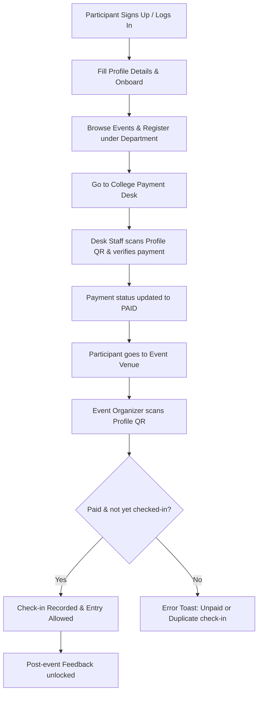

# Mitilence 25 • National Level Technical Symposium

[](https://nextjs.org/)
[](https://firebase.google.com/)
[](https://tailwindcss.com/)
[](https://www.typescriptlang.org/)
[](LICENSE)

**Mitilence 25** is the official web application for managing and participating in the prestigious annual National Level Technical Symposium hosted by **Manakula Vinayagar Institute of Technology (MVIT)**, Puducherry. 

The platform connects participants, payment desks, event organizers, and administrators into a single, unified workflow. It handles onboarding, department-level event registrations, offline cash collection at counter desks, real-time ticket scanning at event entries, live dashboards, and automated spreadsheet report generation.

---

## 🚀 Official Launch & Reception

The MITILENCE 2025 Events Website was officially launched on **March 14, 2025**, at **MVIT College**!

*   **Chief Guest:** **Shri. Pradeep VM**, Head of Security at Ladera Technology Pvt. Ltd., Chennai.
*   **Honored Dignitaries:**
    *   **Dr. Malarkkan Sundararaj** (Principal, MVIT)
    *   **Dr. P. Sivakumar** (Convenor, MVIT)
    *   **Dr. M. Jayekumar** (Placement Officer, MVIT)

### 📊 Engagement & Stats (First 9 Days)
*   📈 **3,267 unique visitors** in just 9 days since going live for the public!
*   👀 **17,302 page views**, showing high engagement across different sections.
*   📝 **150+ feedback responses** from participants, collected via the user-friendly feedback form.
*   ⚡ **0 downtime interruptions** during the entire event duration, ensuring a highly reliable and smooth user experience.

### 🔗 Media & Links
*   📽️ **Launch Video:** [Watch the Website Launch Video](https://lnkd.in/ghVeGs3D)
*   🔗 **Official Announcement:** [LinkedIn Post](https://www.linkedin.com/posts/yuvaraja-murali_mvit-mitilence-mitilence2025-activity-7307045481870675968-xjDX)
*   🌐 **Live Platform:** [mitilence.1he.dev](https://mitilence.1he.dev)

---

## 🚀 Key Features

### 👤 For Participants
*   **Seamless Authentication:** Single provider authentication using **Google OAuth** for a secure, seamless login experience (no email/password logins).

*   **Unified Onboarding:** Profile setup collecting college details, enrollment numbers, contact info, and department.
*   **Dynamic Event Catalog:** Real-time search, filter, and categorization (Technical, Non-Technical, Presentation, Expo) across multiple academic departments.
*   **Dynamic SEO Share Links:** Dynamically rendered OpenGraph preview cards via `/e/[eventId]` for smooth social sharing on WhatsApp, Telegram, or Twitter.
*   **Profile QR Card:** Individual digital QR codes generated from the participant's unique ID for instantaneous ticket scanning.
*   **Event Feedback:** Feedback collection system unlocked automatically after a participant makes their payment and attends events.

### 💳 Offline Payment Desk (`paymentDesk` Role)
*   **QR Scanner Integration:** Integrated device camera QR code reader to scan a participant's Profile QR and locate their registration info instantly.
*   **Manual Email Search:** Backup search input to locate participants using their email addresses.
*   **Counter Payment Collection:** Verify payment offline and log it to Firestore under the department.
*   **Dual Pricing Structure:** Selectable pricing logic distinguishing between **Internal** (₹100) and **External** (₹200) participants with explicit "CONFIRM" verification prompts.

### 🎙️ Event Organizers (`organizer` Role)
*   **Venue Check-in Scan:** Live scanning of Profile QRs at the door to check participants into specific technical/non-technical events.
*   **Double-Check Verification:** Automatic database checks verifying that:
    1.  The participant has paid their fee for that department's events.
    2.  The participant is not already checked into the event (prevention of duplicate entry).
*   **Live Attendance Lists:** View dynamic tables of checked-in participants.

### 📊 Admins & Superadmins (`admin` / `superadmin` Roles)
*   **Department Admins:** Full view of all registered participants, fee statuses, and event registrations within their respective departments.
*   **Superadmins:** Ability to toggle between all college departments (CSE, IT, ECE, EEE, Mech, etc.) to view global statistics and check-in statuses.
*   **Excel Export:** Automated Excel spreadsheet generator using `exceljs`, exporting comprehensive student lists, payment states, and check-in logs directly from the browser.

---

## 🛠️ Tech Stack & Architecture

### Frontend
*   **Framework:** [Next.js 15](https://nextjs.org/) (App Router, Server-side Rendering for sharing SEO links)
*   **Language:** [TypeScript](https://www.typescriptlang.org/)
*   **UI Components:** [HeroUI (formerly NextUI) v2](https://heroui.com/) & [Radix UI](https://www.radix-ui.com/)
*   **Styling:** [Tailwind CSS](https://tailwindcss.com/) & [Framer Motion](https://www.framer.com/motion/)
*   **Typography & Effects:** Clash Display font, LineShadowText, and Shimmer effects via MagicUI.

### Backend & Database (Serverless)
*   **Server Endpoints:** Next.js Route Handlers (`app/api/*`)
*   **Database & Auth:** Firebase Firestore, Realtime Database, and Firebase Authentication
*   **Server Actions Security:** [Firebase Admin SDK](https://firebase.google.com/docs/admin/setup) verifying tokens and checking custom claims.
*   **API Protection:** Google ReCAPTCHA v3 + Firebase App Check client-side integration.

---

## 🔄 Application Workflow



---

## 🔐 Role-Based Access Control (RBAC)

The app assigns custom tokens (Custom Claims) inside Firebase Auth to restrict dashboard routes:

| Role | Access Permissions | Restricted Routes |
| :--- | :--- | :--- |
| **Participant** | Profile info, QR display, Event discovery, Feedback submission. | `/profile`, `/events` |
| **Payment Desk** | Search/Scan users, verify offline fee payments, assign Internal/External tags. | `/paymentDesk` |
| **Organizer** | View event participants, scan QR code for checked-in validation. | `/organizer` |
| **Admin** | View all department registrations, verify payments, download Excel records. | `/admin` |
| **Superadmin** | Cross-department access, view overall statistics, download global Excel sheets. | `/superadmin` |

---

## 🛡️ Secure Firebase Rules Policy

To ensure high data integrity, strict access control, and user privacy, the application implements robust security rules for both Firestore and Realtime Database:

### 1. Cloud Firestore Rules ([rules/firestore.rules](file:///home/thewhitehat/Documents/Works/Mitilence-MVIT/rules/firestore.rules))
*   **Users Collection (`/users`):** Global read, write, update, and delete actions are blocked at the collection root.
*   **User Documents (`/users/{userId}`):** Users can only read, write, and update their own document if they are authenticated and their Firebase Auth UID matches the document's `userId`. Deletion is disallowed.
*   **Payments (`/payments/{userId}`):** Access is strictly regulated. A user can read their own payments. Additionally, `superadmin` and department-specific `admin`/`organizer` roles can read payments matching their department. Modifying payments (write, update, delete) is completely restricted on the client.
*   **Organizers (`/organizers/{userId}`):** Organizers can read their own coordinator record. Deletion and modification are blocked.
*   **Feedbacks (`/feedbacks/{userId}`):** Authenticated users can read their own feedback. They can create a feedback document only if it does not already exist (ensuring single feedback submission). Modifying or deleting feedback is disabled.
*   **Events (`/events/{eventId}`):** Events are publicly readable (`allow read: if true`) so guests can browse the catalog. All write operations are disabled from the client.

### 2. Firebase Realtime Database Rules ([rules/database.rules.json](file:///home/thewhitehat/Documents/Works/Mitilence-MVIT/rules/database.rules.json))
*   **Default Deny:** Both global read and write operations are disabled (`false`) by default.
*   **Read-Only Paths:** Paths such as `/administration`, `/departments`, and `/faqs` are publicly readable for general app consumption, but writes are strictly disabled.

---

## ⚙️ Environment Configuration

To run this application locally or in production, configure the environment variables by copying `.env.example` to `.env`:

```bash
cp .env.example .env
```

Fill in the following details:

```env
# Exposed client-side keys
NEXT_PUBLIC_CDN_URL="https://your-cdn-link.com"
NEXT_PUBLIC_FIREBASE_CLIENT_JSON='{"apiKey": "...", "authDomain": "...", ...}'
NEXT_PUBLIC_RECAPTCHA_SITE_KEY="your-recaptcha-site-key"

# Private Server Key (Firebase Admin SDK Service Account JSON as a single-line string)
FIREBASE_ADMIN_JSON='{"type": "service_account", "project_id": "...", ...}'
```

---

## 💻 Local Development Setup

Follow these steps to run the development server locally:

### 1. Install Dependencies
```bash
npm install
```

### 2. Launch Local Server
```bash
npm run dev
```

Open [http://localhost:3000](http://localhost:3000) in your browser.

### 3. Build for Production
To test the production build locally:
```bash
npm run build
npm start
```

---

## 🧑‍💻 Development Team

*   **Yuvaraja Murali** - *FullStack Developer* (CSE, Batch 2022 - 2026) — [Portfolio](https://1he.dev)
*   **Harish Mohan** - *Frontend Developer* (CSE, Batch 2022 - 2026) — [Portfolio](https://hari.1he.dev)
*   **Nivetha Kumar** - *UI/UX Designer* (IT, Batch 2022 - 2026) — [Instagram](https://www.instagram.com/_.nive_designs)

---

## 📄 License

This project is licensed under the MIT License - see the [LICENSE](LICENSE) file for details.
